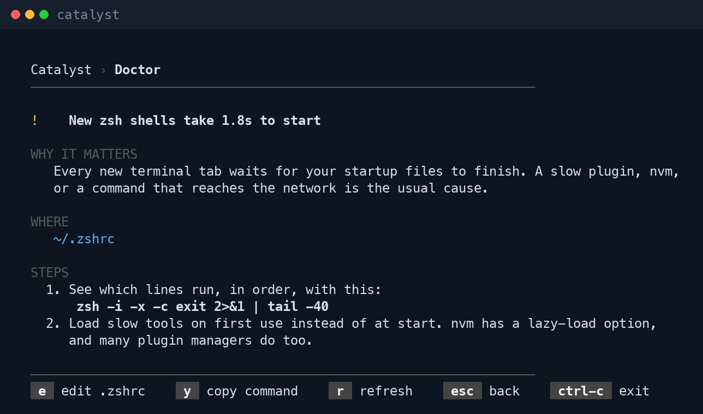
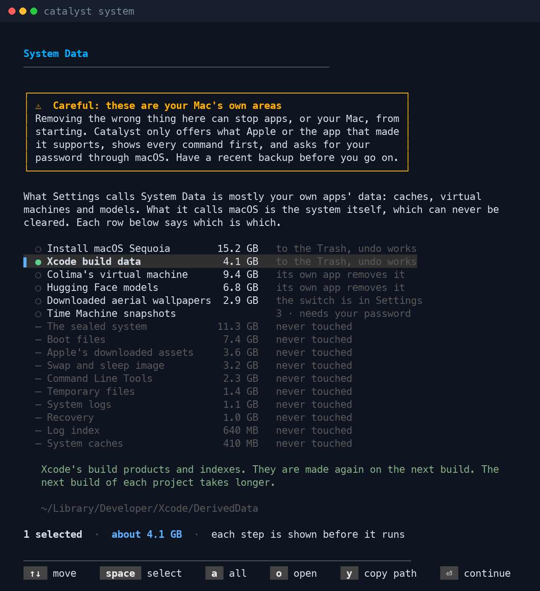
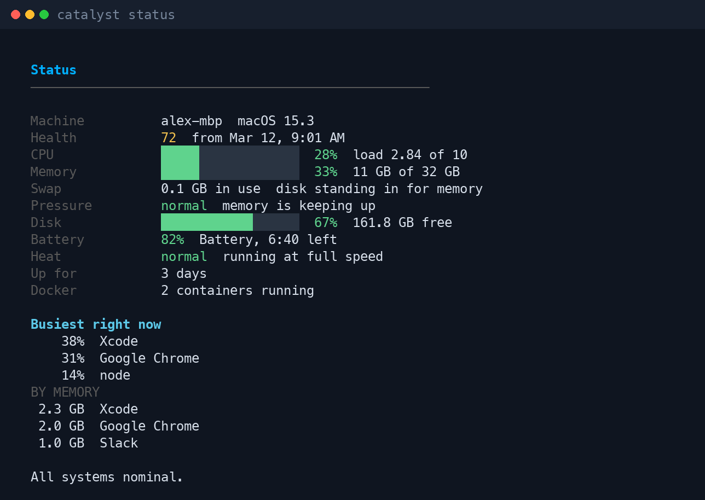
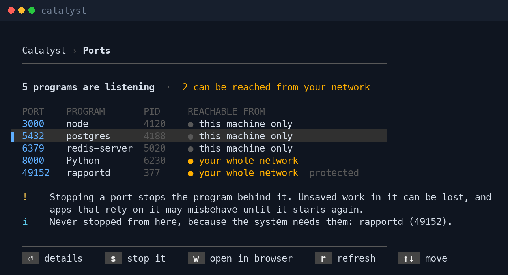
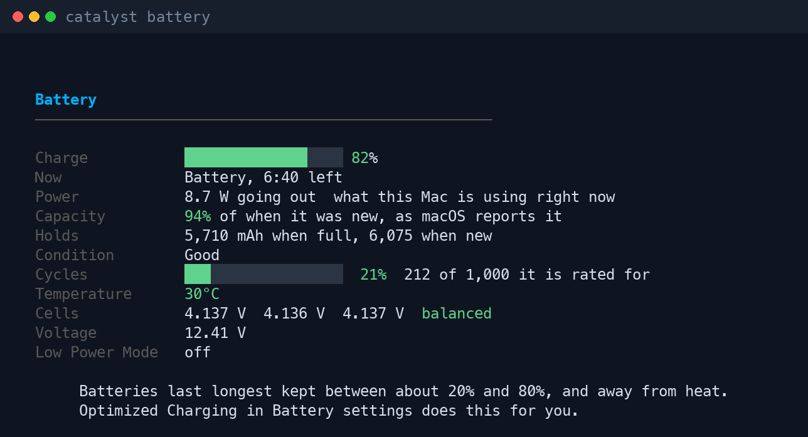
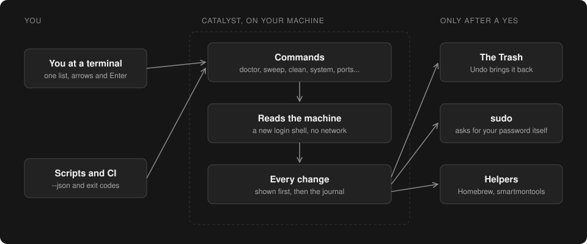

<div align="center">


# Catalyst

**The doctor for your dev environment.** When your machine feels wrong, run one command. It tells you why, in plain words, and fixes what it safely can.

<a href="#install"></a>
<a href="https://theappfoundry.co/catalyst"></a>
<a href="https://discord.gg/CtxC3ADy76"></a>

macOS and Linux · MIT licence · made by [The App Foundry](https://theappfoundry.co)

</div>

```bash
curl -fsSL https://raw.githubusercontent.com/theappfoundryco/catalyst/main/get.sh | sh
```

<div align="center">


*An invented machine.*

</div>

## What it is

Dev machines break quietly. `npm` resolves but will not run. Homebrew's tools sit behind Apple's on your PATH. `pip3` installs for a different Python than `python3` runs. A new terminal takes two seconds to open, an API key is sitting in your shell history, and `JAVA_HOME` points at a JDK you removed last year.

None of that is hard to fix. It is hard to notice. Catalyst looks at the machine the way a new terminal sees it and tells you what it finds, in about a second. Then every result is something you can act on: move to a finding and press Enter for the file, the line and the steps, or let Catalyst make the change, shown first and undoable. It is one small program with nothing else to install: no Python, no Node, no account, and it sends nothing anywhere.

## What you get

| Area | What it does |
|---|---|
| **The list** | `catalyst` on its own, or `kit` for short, opens one list on the terminal's separate screen, so nothing piles up in your scrollback. Arrows move, Enter opens, Esc goes back, Ctrl-C twice leaves. It greets you by name, and a dot beside your health score breathes in its colour, faster when something needs you. |
| **Doctor** | Every check at once, a health score and a trend. Each finding opens a guide: why it matters, the real file and line, and numbered steps, with keys to edit, fix, copy or open the right Settings page. `r` checks again. |
| **Sweep** | Build artifacts from old projects, and only the ones git confirms are disposable. |
| **Clean** | App caches and old logs, which rebuild themselves. Open apps are left alone, and each row shows its path and opens in Finder. |
| **Space and System Data** | Where your storage goes, folder by folder, and what macOS means by "System Data" and "macOS". Only what Apple or the owning app supports can be removed, every command is shown first, and macOS's own volumes are explained and locked. |
| **Status and Battery** | Load, memory and its pressure, swap, heat, uptime and the busiest apps, live every two seconds. The battery's capacity in mAh against new, cycles against its rating, power in or out, and its cells. |
| **Disk and Network** | Drive health, and with smartmontools its wear and lifetime reads and writes. Wi-Fi signal, VPN, DNS timed against public resolvers, a test for any address, and a speed test when you ask. |
| **Ports** | What is listening and from where. Details, open in the browser, or stop one: it is asked to quit first, and the system's own are never touched. |
| **Startup, SSH keys and PATH** | What starts by itself, with Login Items a key away. Copy a public key or fingerprint. Your PATH as a table, with the file that adds each folder. |
| **Undo and history** | Reverses the last change, including edits to a startup file. `catalyst log` lists everything Catalyst ever changed. |

<details>
<summary>More screens</summary>
<br>
<p>
  
  
  
  
  
  
</p>
<p><em>All on an invented machine.</em></p>
</details>

### What the doctor checks

| | |
|---|---|
| **Your shell** | Syntax errors in startup files, how long a new shell takes and what is slowing it down, dead or repeated PATH folders, Homebrew behind Apple's tools (and the exact line that put it there) |
| **Your tools** | Anything that resolves but fails to run, Command Line Tools or a compiler, git identity, `pip3` and `python3` disagreeing, Apple's own Python, `npm` hiding from nvm, npm owned by root, a broken `JAVA_HOME`, Intel Homebrew on Apple silicon |
| **Keys and secrets** | Private keys other users can read (found by content, not by name), weak keys, API keys in your shell history, the firewall |
| **This machine** | Disk space and inodes, heavy swapping, leftover Docker containers and images, startup items whose program is gone, failed systemd units, a restart waiting, oversized logs and caches |

## How it fits together



- **Rows you can act on.** A command marks the lines worth acting on, and the list puts a cursor there. Keys open the next screen or act in place, and Esc comes back to where you were, measured again if something changed.
- **One way to change anything.** Fixes are data, so the preview cannot disagree with what runs. Removals go to the Trash, startup-file edits keep a copy first, and everything lands in the journal that Undo reads.
- **Root through sudo's own prompt.** When something needs admin rights, the command is shown, you say yes, and sudo asks for your password on your terminal. Catalyst never reads it.

## Helpers

Optional tools that let Catalyst see more. Setup offers them once, a no is remembered, and they are under More, Helpers whenever you want them. Uninstalling Catalyst never removes them.

| Helper | What it unlocks |
|---|---|
| Homebrew | Installs the other helpers, and most developer tools. Its own installer, shown in full first. |
| smartmontools | Drive wear, total read and written, spare cells, temperature and power-on hours on the Disk screen. |

## Built to be trusted

- **Reading never needs permission. Changing always does.** Every change is shown before it happens, and nothing happens without a yes.
- **Everything is undoable or stated.** Removals go to the system Trash, never `rm`. A startup file is copied before it is edited, and zsh checks the result. Every change lands in a journal. What cannot be undone says so first.
- **System Data's rule.** An area is offered only when Apple, the distribution or the app that made it has a supported way to remove it, and that way is what runs. The sealed system, boot files, recovery, swap and the system's logs are measured, explained and locked.
- **Clean's rule.** Only what rebuilds itself, and an app's cache only while the app is closed. Models, virtual machines and backups are yours, and are removed only with their own tool.
- **Sweep's rule.** A folder has to pass four tests: a marker file proves what kind of project it is, it cannot be a symlink, git must confirm it is ignored and tracks nothing in it, and the project must have been idle for 14 days. With `--yes`, only what rebuilds by itself is taken.
- **It never sees your password.** If something needs root, Catalyst shows the command and asks, then `sudo` asks for your password on your terminal. Catalyst never reads or keeps it.
- **No remote code.** Nothing it runs or writes is downloaded, except Homebrew's own installer, shown in full and run only if you say yes in Helpers. There is no backend, no catalog and no telemetry. Network calls happen only when you ask: `net`, `update`, a speed test or your public IP.
- **Secrets are never printed.** The history check reports how many lines, never what they hold, and `--json` follows the same rule.
- **A failed check is not a pass.** Checks end as pass, issue, skipped with a reason, or error. Only one that truly ran can pass.
- **Tested.** Sweep's safety rules run against real git repositories in the test suite, and every parser runs against recorded output from both systems.

## Install

Requirements: macOS or Linux, on Apple silicon, Intel or ARM. That is all.

```bash
curl -fsSL https://raw.githubusercontent.com/theappfoundryco/catalyst/main/get.sh | sh
```

It downloads the newest release, checks its checksum, puts one file in `~/.local/bin` with `kit` as a shorter name for it (unless something else is already called kit), offers to add that folder to your PATH, and opens Catalyst. The first time, it asks what to call you and offers the helpers worth having. In a script or CI it only installs, and `CATALYST_NO_OPEN=1` does the same at a terminal. Prefer to read it first?

```bash
curl -fsSL https://raw.githubusercontent.com/theappfoundryco/catalyst/main/get.sh -o get.sh
sh get.sh
```

Or build it yourself, with Go:

```bash
git clone https://github.com/theappfoundryco/catalyst.git
cd catalyst
make build
```

## Update and uninstall

```bash
catalyst update           # moves to the newest release, after checking its checksum
catalyst update --check   # only says whether there is one
catalyst uninstall        # removes the program, its PATH line and its files
```

Uninstalling leaves Homebrew and anything installed with it alone, and what Catalyst moved to the Trash stays there.

Coming from the old Catalyst Mac app? `catalyst legacy` shows what the app left behind (its shell line, the password it saved in your Keychain, its helper tool) and removes each one only when you say yes.

## For scripts and CI

```bash
catalyst doctor --json              # a versioned report
catalyst doctor --only keys         # one group
catalyst sweep --dry-run --json     # what it would offer
```

Exit codes: 0 fine, 1 issues found, 2 usage error, 3 a check could not run. Colour turns itself off in pipes and with `NO_COLOR`.

## Meet Kit


Cat + alyst. Kit lives in one place, the top of the home screen, and never follows you into a command or a script. Its mood is real information about what just happened: a doctor's hat after a checkup, alarmed only for something critical, a party only on a clean 100, and pleased after a sweep. `catalyst config set mascot off` if you would rather not, and `catalyst config set animations off` keeps Kit and the health dot still. Adding a mood is one of the friendliest first pull requests here.

## Documentation and community

| | |
|---|---|
| Project page | [theappfoundry.co/catalyst](https://theappfoundry.co/catalyst) |
| Questions and ideas | [Discussions](https://github.com/theappfoundryco/catalyst/discussions) and [Discord](https://discord.gg/CtxC3ADy76) |
| Bugs and check ideas | [Issues](https://github.com/theappfoundryco/catalyst/issues/new/choose) |
| Security problems | Report privately, see [SECURITY.md](SECURITY.md) |
| Add a check | [docs/ADDING_A_CHECK.md](docs/ADDING_A_CHECK.md) |

## Contribute

A check is one small file, a sweep rule is one line, and both are tested with recorded output, so you can work on Linux checks from a Mac and the other way round. Start with [CONTRIBUTING.md](CONTRIBUTING.md), and please follow the [Code of Conduct](CODE_OF_CONDUCT.md).

## Licence

[MIT](LICENSE). Made by [The App Foundry](https://theappfoundry.co) · [Terms](https://theappfoundry.co/terms) · [Privacy policy](https://theappfoundry.co/privacy)
