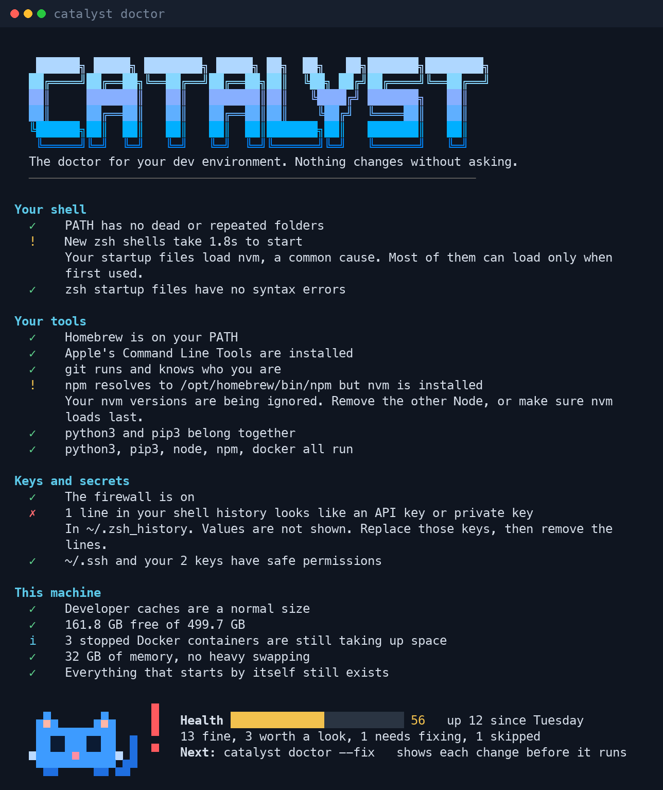
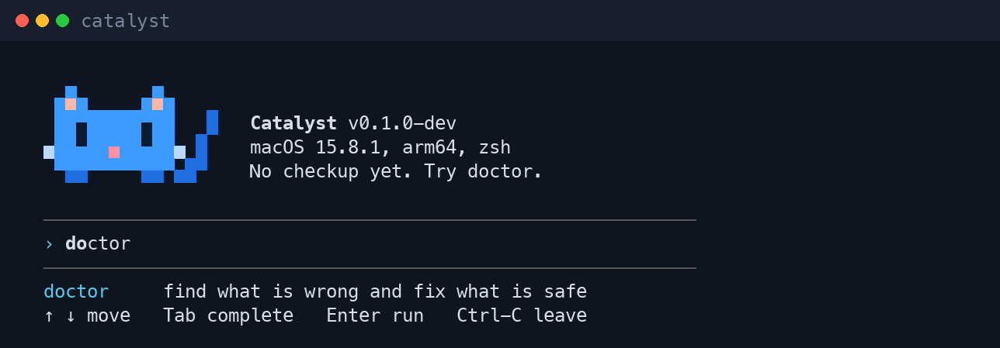
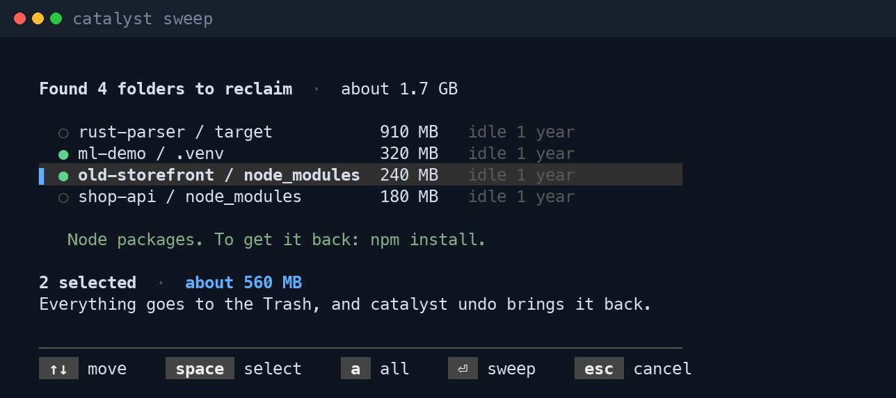

<div align="center">


# Catalyst

**The doctor for your dev environment.** When your machine feels wrong, run one command. It tells you why, in plain words, and fixes what it safely can.

<a href="#install"></a>
<a href="https://theappfoundry.co/catalyst"></a>
<a href="https://discord.gg/CtxC3ADy76"></a>

macOS and Linux · MIT licence · made by [The App Foundry](https://theappfoundry.co)

</div>

```bash
curl -fsSL https://raw.githubusercontent.com/theappfoundryco/catalyst/main/get.sh | sh
```

<div align="center">



*An invented machine.*

</div>

## What it is

Dev machines break quietly. `npm` resolves but will not run. Homebrew's tools sit behind Apple's on your PATH. `pip3` installs for a different Python than `python3` runs. A new terminal takes two seconds to open, an API key is sitting in your shell history, and `JAVA_HOME` points at a JDK you removed last year.

None of that is hard to fix. It is hard to notice. Catalyst looks at the machine the way a new terminal sees it and tells you what it finds, in about a second. It is one small program with nothing else to install: no Python, no Node, no account, and it sends nothing anywhere.

## What you get

| Command | What it does |
|---|---|
| `catalyst` | Opens one list: where things stand, and everything below. Arrow keys move, Enter opens. |
| `catalyst doctor` | Runs every check at once and gives a health score and a trend. `--fix` shows each change before it happens. |
| `catalyst sweep` | Reclaims space from build artifacts, and only the ones git confirms are disposable. |
| `catalyst undo` | Reverses the last change. `catalyst log` lists everything Catalyst ever changed. |
| `catalyst status` | A one-glance card: load, memory, disk, battery, Docker. |
| `catalyst disk` | Volumes, drive health and wear. |
| `catalyst battery` | Charge, cycles and condition. |
| `catalyst net` | Router, DNS and latency, so you can tell which one is the problem. |
| `catalyst ports` | What is listening. `ports kill 3000` stops only the listener, never what is connected to it. |
| `catalyst startup` | What starts by itself, and which of it is broken. |
| `catalyst ssh` | Your keys, and whether they are safe. |
| `catalyst path` | Your PATH: dead folders, repeats, what hides what, and which file added each. |

<p align="center"></p>

<p align="center"></p>

### What the doctor checks

| | |
|---|---|
| **Your shell** | Syntax errors in startup files, how long a new shell takes and what is slowing it down, dead or repeated PATH folders, Homebrew behind Apple's tools |
| **Your tools** | Anything that resolves but fails to run, Command Line Tools or a compiler, git identity, `pip3` and `python3` disagreeing, Apple's own Python, `npm` hiding from nvm, npm owned by root, a broken `JAVA_HOME`, Intel Homebrew on Apple silicon |
| **Keys and secrets** | Private keys other users can read (found by content, not by name), weak keys, API keys in your shell history, the firewall |
| **This machine** | Disk space and inodes, heavy swapping, leftover Docker containers and images, startup items whose program is gone, failed systemd units, a restart waiting, oversized logs and caches |

## Built to be trusted

- **Reading never needs permission. Changing always does.** `doctor` and `sweep` change nothing unless you say so.
- **Everything is undoable or stated.** Removals go to the system Trash, never `rm`. Every change lands in a journal. What cannot be undone says so first.
- **Sweep's rule.** A folder has to pass four tests: a marker file proves what kind of project it is, it cannot be a symlink, git must confirm it is ignored and tracks nothing in it, and the project must have been idle for 14 days. With `--yes`, only what rebuilds by itself is taken.
- **It never sees your password.** If something needs root, Catalyst prints the command for you to run.
- **No remote code.** Nothing it runs or writes is downloaded. There is no backend, no catalog and no telemetry. The only network calls are `catalyst net` and `catalyst update`, when you ask.
- **Secrets are never printed.** The history check reports how many lines, never what they hold, and `--json` follows the same rule.
- **A failed check is not a pass.** Checks end as pass, issue, skipped with a reason, or error. Only one that truly ran can pass.
- **Tested.** Sweep's safety rules run against real git repositories in the test suite, and every parser runs against recorded output from both systems.

## Install

Requirements: macOS or Linux, on Apple silicon, Intel or ARM. That is all.

```bash
curl -fsSL https://raw.githubusercontent.com/theappfoundryco/catalyst/main/get.sh | sh
```

It downloads the newest release, checks its checksum, puts one file in `~/.local/bin`, offers to add that folder to your PATH, and opens Catalyst. In a script or CI it only installs, and `CATALYST_NO_OPEN=1` does the same at a terminal. Prefer to read it first?

```bash
curl -fsSL https://raw.githubusercontent.com/theappfoundryco/catalyst/main/get.sh -o get.sh
sh get.sh
```

Or build it yourself, with Go:

```bash
git clone https://github.com/theappfoundryco/catalyst.git
cd catalyst
make build
```

## Update and uninstall

```bash
catalyst update           # moves to the newest release, after checking its checksum
catalyst update --check   # only says whether there is one
catalyst uninstall        # removes the program, its PATH line and its files
```

Coming from the old Catalyst Mac app? `catalyst legacy` shows what the app left behind (its shell line, the password it saved in your Keychain, its helper tool) and removes each one only when you say yes.

## For scripts and CI

```bash
catalyst doctor --json              # a versioned report
catalyst doctor --only keys         # one group
catalyst sweep --dry-run --json     # what it would offer
```

Exit codes: 0 fine, 1 issues found, 2 usage error, 3 a check could not run. Colour turns itself off in pipes and with `NO_COLOR`.

## Meet Kit


Cat + alyst. Kit lives in one place, the top of the home screen, and never follows you into a command or a script. Its mood is real information about what just happened: a doctor's hat after a checkup, alarmed only for something critical, a party only on a clean 100, and pleased after a sweep. `catalyst config set mascot off` if you would rather not. Adding a mood is one of the friendliest first pull requests here.

## Documentation and community

| | |
|---|---|
| Project page | [theappfoundry.co/catalyst](https://theappfoundry.co/catalyst) |
| Questions and ideas | [Discussions](https://github.com/theappfoundryco/catalyst/discussions) and [Discord](https://discord.gg/CtxC3ADy76) |
| Bugs and check ideas | [Issues](https://github.com/theappfoundryco/catalyst/issues/new/choose) |
| Security problems | Report privately, see [SECURITY.md](SECURITY.md) |
| Add a check | [docs/ADDING_A_CHECK.md](docs/ADDING_A_CHECK.md) |

## Contribute

A check is one small file, a sweep rule is one line, and both are tested with recorded output, so you can work on Linux checks from a Mac and the other way round. Start with [CONTRIBUTING.md](CONTRIBUTING.md), and please follow the [Code of Conduct](CODE_OF_CONDUCT.md).

## Licence

[MIT](LICENSE). Made by [The App Foundry](https://theappfoundry.co) · [Terms](https://theappfoundry.co/terms) · [Privacy policy](https://theappfoundry.co/privacy)
